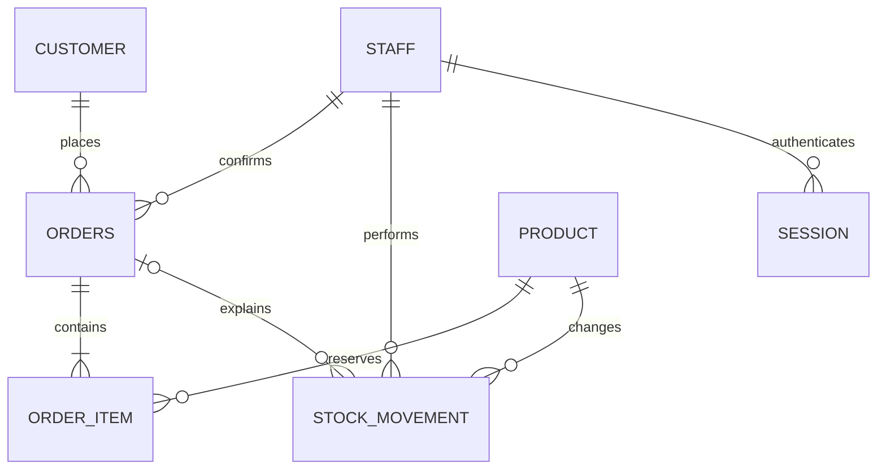
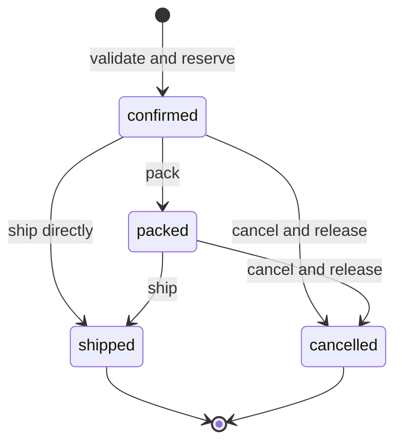

# Architecture and decisions

## Data model

The `ORDER_ITEM` bridge implements the many-to-many relationship between orders and products. There are six business tables plus the technical `session` table. `inventory` is a view, not another stored stock counter. Django manages the tables through models and migrations. The initial migration freezes the legacy SQL for lossless adoption of existing files; `database/schema.sql` remains a reference. `setup_stockroom` applies migrations and adds fictional demo data only to an empty database.

| Table | Key and main rules |
|---|---|
| staff | staff_id PK; login case-insensitive UNIQUE; role CHECK; password_hash never returned |
| customer | customer_id PK; shop_name case-insensitive UNIQUE |
| product | sku stable PK; positive integer price; nonnegative physical stock and reorder threshold |
| orders | order_id PK; customer_id and staff_id FK; channel/status CHECK; server timestamps |
| order_item | item_id PK; order_id and sku FK; UNIQUE(order_id,sku); positive integer quantity; historical price |
| stock_movement | movement_id PK; SKU/staff/order FK; physical_delta and reserved_delta; at least one nonzero; append-only triggers |
| session | SHA-256 token hash PK; staff FK; server-side expiry |

SKU format is validated by the API (`AAA-MODEL-AAA`). SQLite type affinity alone does not enforce integer-only values against an arbitrary direct file writer; strict integer validation is in Django Forms. Application accounts do not have direct database access. DB administrators with file access remain trusted. An external writer can bypass business rules and must not be used as an application integration path.

## Atomic reservation

1. Authenticate and authorize the actor.
2. Validate customer, channel and lines; forbid duplicate SKU lines and non-integer quantities.
3. `BEGIN IMMEDIATE` obtains SQLite's write lock before reading availability.
4. Read `Product.objects.inventory()` ORM annotations for every requested SKU and check the full order.
5. Insert order, order lines and `reserve` history rows.
6. Commit once; on any exception, roll back all changes.

The competing request waits for the write lock. When it runs, it reads the newly reduced availability. No client-side number is trusted. Busy timeout is 15 seconds. This is coarse locking appropriate for one small warehouse, with limited write concurrency.

## State transitions

There is no persisted `new` state in v1. Unconfirmed form entries remain in the browser; confirming is the only creation operation. This intentionally narrows the Task 9 status list. `packed` still reserves stock; terminal states do not. Order quantities and customer cannot be edited after confirmation; cancel and recreate instead.

| Event | Shelf delta | Reserved delta | Available effect |
|---|---:|---:|---:|
| Delivery of 5 | +5 | 0 | +5 |
| Reserve 3 | 0 | +3 | −3 |
| Cancel those 3 | 0 | −3 | +3 |
| Ship those 3 | −3 | −3 | 0 |
| Correction −2 | −2 | 0 | −2, only if enough unreserved stock |

`stock_movement` explains changes; `product` plus active order lines determine the current stock truth. The ledger is not replayed on every request. A zero-stock product receives no zero-quantity opening movement.

## Design corrections from earlier artifacts

- Added CUSTOMER instead of repeated free-text shop names in ORDERS.
- Corrected INNER JOIN replenishment logic to a LEFT JOIN aggregate, exposed through inventory view.
- Included packed reservations as active.
- Added cancellation release and prevented repeated terminal transitions.
- Preserved historical unit_price_kzt in order_item. This is a transaction fact, not an accidental copy of current catalogue price.
- Split history into physical/reserved deltas so reservation and shipment cannot be confused.
- Expanded sales access from the overly narrow read-only plan to include customer creation and order confirmation, required by the actual business workflow. It still cannot change physical stock, cancel, ship, read staff or access backups.
- Replaced hardware-plan PIN with password-based personal accounts.

## Security and recovery

Django ORM parameterized queries; Django scrypt salted password hashes with legacy compatibility; random session tokens stored as hashes; expiry after eight hours; HttpOnly/SameSite strict cookies. HTTP is accepted only for the intended loopback demonstration, with `STOCKROOM_SECURE_COOKIE=1` available for a separately configured HTTPS deployment. Mutating requests reject untrusted browser origins. No wildcard CORS is enabled. Registration always creates sales accounts and forbids unknown fields, including role injection. Per-IP in-memory authentication rate limiting is a local safeguard, not a distributed defence.

Permissions are checked by Django view decorators and UI controls are additional convenience, not the security boundary. Deactivating or changing another user revokes their sessions. A user cannot change their own access. Audit rows retain actor IDs and timestamps but account privilege changes do not yet have a separate administrative audit ledger.

Backups use sqlite3's backup API for a consistent snapshot and `PRAGMA integrity_check`. The daily scheduler runs only while the server is running. Local restore test verifies the copied inventory; the separate offline restore utility creates a safety copy and revokes sessions. No full-network firewall or OS USB policy is installed by the app. These remain operational controls described in the semester plan.
