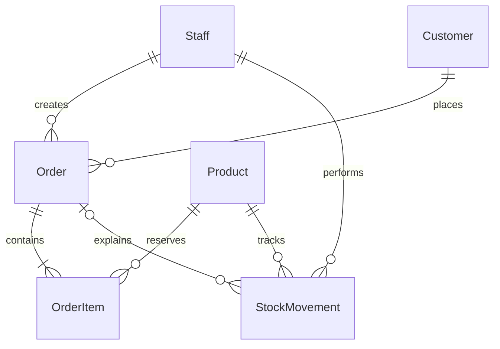

# Кто какую часть объясняет

| Участник | Ответственность | Файлы | Проверяемый результат |
|---|---|---|---|
| Nurdaulet 24B031742 | Frontend | frontend/src/app, styles.css | Регистрация, Overview, поиск и карточка товара, форма и ошибка заказа |
| Aksungkar 24B031908 | Backend | inventory/views.py, services.py, serializers.py | Остаток проверяется сервером; резерв, отмена, отгрузка и history атомарны |
| Akylbek 24B032013 | База | inventory/models.py, migrations, database/queries.sql | Связанные таблицы, ключи, ограничения, реальные 18 товаров и SQL |
| Dias 24B032021 | QA | inventory/tests.py, qa | 15 тестов, 20 записей, ручной checklist и фактические результаты |
| Oren 24B031750 | Backup & Recovery | maintenance.py, run_stockroom.py, integration/restore.py | План восстановления и показ возврата заказа, остатка и истории из копии |

## Nurdaulet: порядок чтения

1. app.html: общий layout и router-outlet.
2. routes.ts: какая страница открывается по адресу.
3. products.ts и products.html: массив товаров из Store, фильтр, выбор товара.
4. store.ts: один метод request делает HTTP, refresh получает актуальные данные.
5. auth: ngModel, форма, вызов /auth/register или /auth/login.
6. orders: форма передаёт customer_id, channel и lines. Backend возвращает успех либо ошибку, Store обновляет состояние.

signal — данные, computed — значение, зависящее от данных. На защите покажи одну понятную цепочку, а не весь CSS. Оформление можно объяснить через sidebar, panel, table и media queries.

## Aksungkar: порядок чтения

urls.py → views.orders → OrderInput → services.confirm. В services.confirm сначала проверяются все товары, затем создаются заказ, строки и история. @transaction.atomic возвращает всё назад при ошибке. SQLite transaction_mode IMMEDIATE получает write lock до проверки остатков, поэтому конкурирующий запрос читает уже новый reserve. В этой версии select_for_update не используется как фиктивная защита SQLite.

Для отмены статус меняется на cancelled и пишется release. Для отгрузки уменьшается physical stock и пишется sale. Формула reserve считает только confirmed/packed.

## Akylbek: таблицы

- Staff — обычный расширенный Django User, используется также для login.
- Customer — магазин; Order ссылается на него по FK.
- Product — один SKU, цена и физический запас.
- Order — клиент, канал, статус и сотрудник.
- OrderItem — bridge для M:N между Order и Product. UNIQUE(order,product).
- StockMovement — событие изменения physical/reserved, сотрудник и время.

У Django есть дополнительные технические таблицы permissions, session и migrations; они не являются дополнительными бизнес-модулями. Цена unit_price_kzt в строке заказа фиксирует цену сделки. SQL-запрос ниже нельзя заменить пересчётом старых заказов по новой цене.

## Dias: проверки

Открой test_01: GIVEN 10 on shelf и 6 reserved, WHEN request 5, THEN 409 и available остаётся 4. test_07 намеренно ломает history и проверяет rollback. test_15 содержит 20 входных записей. qa/http_check.py проверяет два одновременных канала отдельными HTTP-запросами. Объясняй фактически выполненные свои проверки отдельно от приложенных результатов ИИ.

## Oren: Backup & Recovery

Прочитай run_stockroom.py → maintenance.py → integration/restore.py. Объясни, когда создаётся снимок SQLite, где хранится копия и почему для восстановления после потери компьютера нужна копия на отдельном носителе.

Личный план — провести восстановление на отдельной учебной копии проекта и показать, что вернулись номер тестового заказа, доступный остаток и запись в History. Запиши дату снимка и время восстановления. [Инструкция для разработчика](DEVELOPER_GUIDE.md#run-a-recovery-drill)
