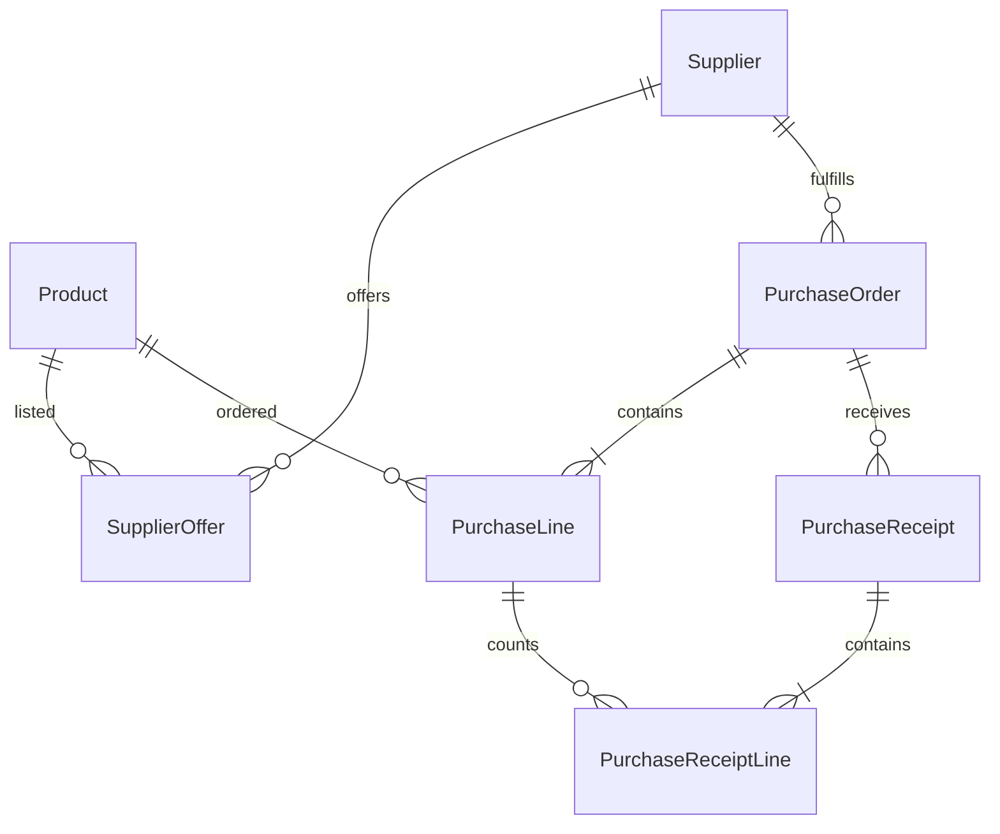

# Акылбек · схема SQLite и данные закупок

**Твоя зона защиты** — как база связывает поставщика, товар, заказ и несколько приёмок. Покажи ограничения, миграцию и демоданные.

## Что открыть и показать

1. Покажи в **Suppliers** демопоставщика с несколькими предложениями и объясни, почему одно предложение относится к конкретному поставщику и SKU.
2. Открой диаграмму и модели ниже. Проследи путь заказа до двух строк приёмки на один товар.
3. Покажи, что миграция `0007_supplier_purchases` добавляет новые таблицы и ограничения. Поле штрихкода в этой же миграции разберёт Орен.
4. По просьбе преподавателя выполни `showmigrations inventory` и запрос чтения. Если Аксункар ещё не принял поставку, результат по заказу должен показать **10 / 0 / 10**.



## Исходники

| Модель или файл | Что объяснить |
| --- | --- |
| [models.py · Supplier и SupplierOffer](../../backend/inventory/models.py#L198) | Поставщик хранит статус договора и срок поставки. Предложение связывает поставщика с SKU, содержит цену, дату обновления и наличие. `NULL` означает неизвестное наличие, `0` — отсутствие товара. Пара «поставщик + товар» уникальна. |
| [models.py · PurchaseOrder и PurchaseLine](../../backend/inventory/models.py#L220) | У заказа есть поставщик и сотрудник. У позиции — SKU, заказанное количество и цена, зафиксированная в момент оформления. Один товар может быть в строках разных заказов, а внутри одного заказа его позиция уникальна. Цена и количество положительные. |
| [models.py · PurchaseReceipt и PurchaseReceiptLine](../../backend/inventory/models.py#L250) | Документ приёмки хранит UUID, заказ и сотрудника. Строка связывает документ с заказанной позицией. У одной заказанной позиции может быть несколько строк в разных приёмках, например **6 + 4**. Внутри одной приёмки позиция уникальна. |
| [models.py · StockMovement](../../backend/inventory/models.py#L113), [0002_history.py](../../backend/inventory/migrations/0002_history.py) | История склада — отдельный журнал движений. Триггеры защищают старые записи журнала от изменения и удаления. |
| [0007_supplier_purchases.py](../../backend/inventory/migrations/0007_supplier_purchases.py#L9), [seed_week12.py · handle](../../backend/inventory/management/commands/seed_week12.py#L12) | Миграция расширяет схему. Seed создаёт демопоставщика, настраивает предложения и создаёт заказ при его отсутствии. |

## Команды для показа

```powershell
& .\.venv-windows\Scripts\python.exe backend/manage.py showmigrations inventory
@'
from pathlib import Path
import sqlite3

database = Path("backend/stockroom.db").resolve().as_uri() + "?mode=ro"
with sqlite3.connect(database, uri=True) as db:
    for row in db.execute("""
        SELECT o.id, o.status, l.product_id, l.ordered_qty,
               COALESCE(SUM(r.qty), 0) AS received,
               l.ordered_qty - COALESCE(SUM(r.qty), 0) AS remaining
        FROM inventory_purchaseorder AS o
        JOIN inventory_purchaseline AS l ON l.order_id = o.id
        LEFT JOIN inventory_purchasereceiptline AS r ON r.purchase_line_id = l.id
        WHERE o.id = ?
        GROUP BY o.id, o.status, l.id, l.product_id, l.ordered_qty
    """, (1,)):
        print(row)
'@ | & .\.venv-windows\Scripts\python.exe -
```

При показе нового заказа подставь его фактический номер вместо `1`. На проверенной рабочей базе миграция `0007` отмечена как применённая. По [QA-отчёту](../../qa/WEEK12_TEST_REPORT.md) пробное обновление сохранило существующие записи в 18 таблицах и оба триггера истории.

**Что сказать.** «Заказанные и принятые количества хранятся в отдельных строках. Поэтому мы можем открыть один заказ, увидеть две поставки и вывести оставшиеся единицы как разницу между заказанным и принятым».
